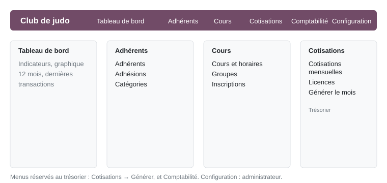
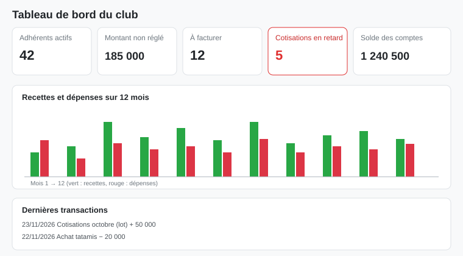

# Guide utilisateur – Club de judo

> **Version du guide : 0.4** · Module `judo_club` 17.0.1.0.0 · Dernière mise à jour : voir [CHANGELOG](../CHANGELOG.md)
>
> Ce guide évolue avec le logiciel. Chaque fonctionnalité porte un statut :
> ✅ disponible · 🚧 en cours · 📝 prévue.
> Les schémas sont fournis dans `docs/images/`. Les captures d'écran réelles (📸) seront ajoutées
> une fois le module installé sur une instance Odoo 17 : les emplacements sont repérés ci-dessous.

---

## Sommaire

1. [Public et rôles](#1-public-et-rôles)
2. [Première connexion et réglages](#2-première-connexion-et-réglages)
3. [Navigation : le menu « Club de judo »](#3-navigation--le-menu-club-de-judo)
4. [Tableau de bord](#4-tableau-de-bord)
5. [Adhérents](#5-adhérents)
6. [Saisons et adhésions](#6-saisons-et-adhésions)
7. [Cours, groupes et inscriptions](#7-cours-groupes-et-inscriptions)
8. [Cotisations mensuelles et licences](#8-cotisations-mensuelles-et-licences)
9. [Facturation](#9-facturation)
10. [Rappels automatiques](#10-rappels-automatiques)
11. [Comptabilité : comptes et transactions](#11-comptabilité--comptes-et-transactions)
12. [Situation financière et relevé PDF](#12-situation-financière-et-relevé-pdf)
13. [Plusieurs clubs dans la même base (multi-société)](#13-plusieurs-clubs-dans-la-même-base-multi-société)
14. [Reçus et tickets de caisse](#14-reçus-et-tickets-de-caisse) *(module judo_receipt)*
15. [Questions fréquentes](#15-questions-fréquentes)

---

## 1. Public et rôles

| Rôle | Ce qu'il peut faire |
|---|---|
| **Secrétariat** | Adhérents, adhésions, cours, inscriptions. Consulte les cotisations et licences. |
| **Trésorier** | Tout le secrétariat, plus : générer les cotisations, facturer, gérer comptes et transactions, imprimer les relevés. |
| **Administrateur** | Tout, plus : saisons, suppression, configuration. |

Les rôles sont attribués dans Paramètres → Utilisateurs → onglet *Droits d'accès*, groupe « Club de judo ».

## 2. Première connexion et réglages

Ordre recommandé (une seule fois, par l'administrateur) :

1. **Paramètres → Société → onglet « Club de judo »** : cotisation mensuelle par défaut, délai entre deux rappels, coordonnées bancaires, mention de pied de facture.
2. **Club de judo → Configuration → Saisons** : créer la saison (ex. `2026-2027`), ses dates et le montant de la licence.
3. **Comptabilité → Comptes et caisses** : créer au moins un compte (banque, caisse, mobile money) avec son solde d'ouverture.
4. **Comptabilité → Catégories de transactions** : ex. « Cotisations » (Recette), « Matériel » (Dépense), « Remboursement fédération » (Remboursement reçu).

📸 *Capture : écran « Paramètres → Société → Club de judo ».*

## 3. Navigation : le menu « Club de judo »

Les menus absents de votre compte correspondent à un rôle que vous n'avez pas.

## 4. Tableau de bord

✅ **Disponible** — menu *Club de judo → Tableau de bord*.

*Schéma indicatif : les valeurs affichées sont fictives.*

Le tableau de bord affiche :

- **Adhérents actifs**, sur le total des fiches ;
- **Montant non réglé** : cotisations et licences en attente de paiement (cliquez pour ouvrir les cotisations) ;
- **À facturer** : éléments sélectionnables pour la facturation ;
- **Cotisations en retard** : factures échues non payées (affiché seulement s'il y en a) ;
- **Solde des comptes** : somme des soldes de tous les comptes et caisses ;
- **Graphique 12 mois** : recettes (vert) et dépenses (rouge) par mois ;
- **Dernières transactions** : cliquez sur une ligne pour l'ouvrir.

📸 *Capture : tableau de bord rempli (à ajouter).*

## 5. Adhérents

✅ **Disponible** — *Adhérents → Adhérents*.

1. Cliquer sur **Nouveau**.
2. Renseigner le nom, le prénom, la date de naissance, les coordonnées et la ceinture.
3. Ajouter une ou plusieurs **catégories** (ex. « Enfants », « Compétiteurs »).
4. Enregistrer. Un **contact comptable** est créé automatiquement : il sert à la facturation.

Onglets de la fiche : **Adhésions**, **Cours**, **Cotisations**, **Licences**. Le chatter en bas de page garde l'historique des modifications.

Filtres utiles : *Actifs*, *Inactifs*, *Archivés* ; regroupement par ceinture ou statut.

## 6. Saisons et adhésions

✅ **Disponible** — *Adhérents → Adhésions*.

- **Adhésion** : un adhérent est inscrit pour une saison. Une seule adhésion par saison et par adhérent.
- **Renouveler** : bouton *Renouveler sur la saison suivante*. L'adhésion actuelle passe en « Renouvelée » et une nouvelle est créée sur la saison suivante.
- **Désistement** : bouton *Désistement*. Les cotisations des mois suivant la date de désistement ne sont plus générées ; le mois en cours reste dû. Le motif peut être noté.

L'historique complet reste visible sur la fiche de l'adhérent.

📝 *Prévu : renouvellement groupé de tous les adhérents d'une saison.*

## 7. Cours, groupes et inscriptions

✅ **Disponible** — menu *Cours*.

1. **Groupes** : niveau de ceinture minimum, tranche d'âge (ex. « Poussins 6–8 ans »).
2. **Cours et horaires** : jour, heure de début et de fin, enseignant, salle, nombre de places (0 = illimité).
3. **Inscriptions** : relier un adhérent à un cours. Un adhérent ne peut pas être inscrit deux fois au même cours, et un cours plein refuse les inscriptions.

Les heures se saisissent au format décimal : `18.5` = 18h30.

## 8. Cotisations mensuelles et licences

✅ **Disponible** — menu *Cotisations*.

### Cotisations mensuelles

- Chaque mois, une cotisation est créée pour chaque adhésion active. Le calcul est automatique chaque jour ; le trésorier peut aussi forcer la génération pour un mois donné : *Cotisations → Générer les cotisations du mois*.
- La génération est **idempotente** : relancer un mois déjà généré ne crée pas de doublon.
- Statuts : **À facturer** → **Facturé** → **Payé** (ou **Annulé**).

### Licences

- Une licence est créée automatiquement à chaque adhésion, au montant de la saison.
- Statuts identiques aux cotisations.

📸 *Capture : liste des cotisations filtrée « À facturer » (à ajouter).*

## 9. Facturation

✅ **Disponible** — réservé au trésorier.

1. Dans *Cotisations mensuelles* ou *Licences*, cocher les lignes à facturer (filtre « À facturer » recommandé).
2. Menu **Action → Facturer les cotisations** (ou *Facturer les licences*).
3. Vérifier les lignes, puis renseigner si besoin :
   - **Date de facture** et **échéance** ;
   - **Remise (%)** : appliquée aux cotisations et licences de la facture ;
   - **Frais supplémentaire** : libellé et montant, ajoutés **une fois par facture** ;
   - **Mention** : texte libre affiché sur la facture (pré-rempli depuis les paramètres).
4. Cliquer sur **Créer les factures**.

Une facture est créée **par contact**. Les éléments facturés passent à « Facturé » et ne sont plus proposés.

📝 *Prévu : gabarit PDF de facture aux couleurs du club.*

## 10. Rappels automatiques

✅ **Disponible** — envoyés chaque jour par le système.

- **Cotisations impayées** : e-mail au contact pour chaque facture échue et non payée.
- **Licences** : e-mail pour chaque licence encore à facturer.
- Un même contact ne reçoit pas un rappel plus d'une fois par délai (7 jours par défaut, réglable dans les paramètres de la société).
- Un contact sans adresse e-mail n'est pas relancé : vérifiez la fiche.

## 11. Comptabilité : comptes et transactions

✅ **Disponible** — réservé au trésorier.

- **Comptes et caisses** : chaque compte a un solde d'ouverture et une date. Le solde actuel se calcule automatiquement.
- **Transactions** : saisir chaque mouvement avec sa date, son compte, sa catégorie et son montant (toujours positif : le sens vient de la catégorie).
  - *Recette* et *Remboursement reçu* ajoutent au solde ;
  - *Dépense* et *Remboursement versé* le diminuent.
- Vous pouvez relier une transaction à un adhérent ou à un tiers, et noter une référence (n° de chèque, de virement…).

> **Important** : les paiements reçus dans la comptabilité Odoo (factures) ne créent pas automatiquement de ligne ici. Saisissez les encaissements de cotisations dans **Transactions**, ou dites-le-nous pour automatiser cette étape (📝 prévu).

Analyse : *Transactions* propose les vues **Graphique** (recettes et dépenses par mois) et **Analyse** (tableau croisé).

## 12. Situation financière et relevé PDF

✅ **Disponible** — *Comptabilité → Situation financière*.

1. Choisir la **période** (du … au …). Par défaut : du 1er janvier à aujourd'hui.
2. Optionnel : choisir un **compte** précis ; sinon, tous les comptes sont consolidés.
3. Lire les indicateurs :
   - **Compte de résultat** : total des recettes, des dépenses et résultat ;
   - **Trésorerie** : solde d'ouverture, entrées, sorties, flux net, solde de clôture ;
   - **Remboursements** reçus et versés ;
   - **Factures à encaisser** à ce jour.
4. Pour un document à remettre (AG, fédération, banque) : **Imprimer le relevé (PDF)**.

Le relevé PDF comprend : la période et le compte, le compte de résultat, la trésorerie, le détail **mois par mois**, puis la liste de toutes les transactions de la période.

Pour un relevé **mensuel** : période du 1er au dernier jour du mois. Pour un relevé **annuel** : période de la saison (ex. 01/09/2026 au 30/06/2027).

📸 *Capture : aperçu du relevé PDF (à ajouter).*

> La situation financière est un outil de pilotage. Pour les états légaux (bilan et compte de résultat officiels), utilisez la comptabilité Odoo.

## 13. Plusieurs clubs dans la même base (multi-société)

✅ **Disponible** — chaque club est une **société** Odoo distincte.

- En haut à droite, le **sélecteur de sociétés** indique le ou les clubs actifs. Cochez le club dans lequel vous travaillez.
- Adhérents, saisons, cours, cotisations, licences, comptes et transactions appartiennent à un club. **Un club ne voit jamais les données d'un autre**, même dans la même base.
- Pour saisir un adhérent pour le club B, sélectionnez d'abord le club B dans le sélecteur. Les nouvelles fiches sont créées dans la société active.
- Un utilisateur peut être rattaché à plusieurs clubs : il sélectionne alors ceux qu'il veut voir.
- Les paramètres (cotisation mensuelle, mentions de facture, coordonnées bancaires) se règlent **séparément pour chaque club** : Paramètres → Sociétés → onglet « Club de judo ».
- Les cotisations et les rappels sont générés club par club ; un club sans saison ne génère rien.

## 14. Reçus et tickets de caisse

✅ **Disponible** — module complémentaire `judo_receipt`.

- **Créer un reçu depuis une recette** : ouvrir la transaction (recette) → *Créer le reçu (ticket)*.
- **Créer un reçu pour des cotisations ou licences** : dans la liste, cochez les lignes d'un même adhérent → *Action → Créer le reçu (ticket)*. Un seul reçu est créé, avec une ligne par élément.
- **Imprimer** : ouvrir le reçu → *Imprimer le ticket*. Le format est le ticket de caisse 80 mm, à envoyer sur l'imprimante thermique.
- Chaque club numérote ses reçus séparément (REC/2026/00001…).
- Retrouver les reçus : Comptabilité → Reçus et tickets.

📸 *Capture : ticket de caisse imprimé (à ajouter).*

## 15. Questions fréquentes

**Un adhérent a payé mais la cotisation reste « Facturée ».**
Le paiement n'a pas encore été rapproché dans la comptabilité Odoo. Une fois rapproché, la cotisation passe à « Payée ».

**Je ne vois pas le menu Comptabilité.**
Votre compte n'a pas le rôle Trésorier. Demandez à l'administrateur de vous l'attribuer.

**Un mois de cotisation manque.**
Vérifiez que l'adhésion est active et que la saison couvre ce mois. Sinon, relancez *Générer les cotisations du mois* pour ce mois : les doublons sont évités.

**Un contact n'a pas reçu de rappel.**
Vérifiez l'adresse e-mail du contact comptable sur la fiche de l'adhérent, et le délai entre deux rappels.

---

*Ce guide est mis à jour à chaque évolution. Signalez toute erreur ou fonctionnalité manquante au responsable du logiciel.*
